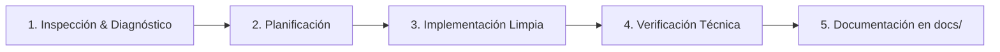

# GEMINI.md - Directrices de Flujo de Trabajo, Buenas Prácticas y Documentación
> **Proyecto:** Almarte Artesanos — E-commerce Platform  
> **Stack:** Next.js (App Router) + React 19 + TypeScript + TailwindCSS + Prisma (MariaDB / MySQL)  
> **Moneda Oficial:** Pesos Colombianos (COP)  

Este documento define las reglas de conducta, flujo de desarrollo, estándares de seguridad y protocolos de documentación que **Gemini / Antigravity** debe seguir obligatoriamente en cada interacción, cambio o corrección dentro de este repositorio.

---

## 1. Filosofía de Trabajo y Principios Rectores

1. **Cero Suposiciones (Verify First):** Inspeccionar siempre el código existente, tipos de datos y dependencias antes de proponer o aplicar cambios.
2. **Respeto a la Arquitectura Existente:** Mantener la separación de responsabilidades:
   - Capa de presentación y rutas: `app/`
   - Componentes UI modulares y reutilizables: `components/`
   - Lógica de negocio, clientes de servicios y utilidades: `lib/`
   - Estado global o proveedores: `context/`
   - Modelado y persistencia: `prisma/`
   - Documentación técnica y bitácoras: `docs/`
3. **Calidad de Producción:** Todo código escrito debe estar listo para producción, libre de código muerto (`dead code`), sin `console.log` de depuración temporales y con manejo defensivo de errores.

---

## 2. Reglas Inviolables del Proyecto

### 2.1. Gestor de Paquetes Exclusivo
- En cualquier entorno (local, pruebas, CI/CD, despliegue y producción en Hostinger), se debe usar **únicamente `yarn`** (`yarn install`, `yarn build`, `yarn start`, `yarn add`, `yarn remove`).
- **PROHIBIDO:** Ejecutar comandos con `npm` o `pnpm`.

### 2.2. Manejo Estricto de Moneda y Precios (COP)
- La moneda oficial y única de la tienda es **Pesos Colombianos (COP)**.
- **Formateo visual:** Todo precio renderizado en catálogo, páginas de producto, carrito, checkout, panel administrativo, facturas y correos debe formatearse con `formatCOP` de `@/lib/currency`.
- **Entrada y edición de precios:** En formularios de administración, endpoints y validaciones, se debe procesar el valor con `parseCOPPrice` y validar con `isValidCOPPrice` (mínimo `$1.000 COP`).
- Esto evita que valores con puntuación colombiana (ej. `$85.000`) se interpreten erróneamente como `$85`.

### 2.3. Next.js App Router & React 19
- **Server Components por Defecto:** Mantener los componentes de `app/` como componentes de servidor a menos que requieran explícitamente interactividad del usuario, eventos DOM, hooks de estado (`useState`, `useEffect`) o APIs del navegador (`'use client'`).
- **Seguridad en Rutas API:** Toda ruta en `app/api/` debe validar el payload de entrada, manejar excepciones con bloques `try/catch` y devolver respuestas HTTP semánticas (`200`, `201`, `400`, `401`, `403`, `404`, `500`).
- **Protección de Rutas Administrativas:** Toda acción que modifique inventario, precios, pedidos o configuración debe validar la sesión y el rol `admin` tanto a nivel de middleware como dentro del endpoint.

### 2.4. Estrategia de Ramas Git y Despliegue Continuo (Hostinger)
- **Auto-deploy en producción (`main`):** La rama `main` en GitHub tiene configurado despliegue automático hacia la infraestructura de producción en Hostinger.
- **Protección estricta de `main` (Regla Inviolable):** La rama `main` **SOLO se toca si el usuario lo permite explícitamente**. Queda estrictamente **PROHIBIDO** realizar commits, merges o push directo a `main` sin autorización previa y puntual del usuario.
- **Rama de desarrollo e integración diaria (`develop`):** Todos los desarrollos, correcciones, mejoras, nuevas funcionalidades y tareas cotidianas deben subirse e integrarse exclusivamente en la rama `develop`.

---

## 3. Protocolo de Flujo de Trabajo Obligatorio (Paso a Paso)

En cada tarea, fix o requerimiento, se debe ejecutar el siguiente ciclo:



### Paso 1: Inspección y Diagnóstico
- Identificar todos los archivos y contratos afectados (tipos TypeScript, esquemas Prisma, componentes padre/hijo, endpoints API).
- Para análisis de impacto o flujos complejos, consultar la skill [noodles](file:///.agents/skills/noodles/SKILL.md).
- Para bugs o fixes: reproducir conceptualmente la causa raíz antes de modificar código.

### Paso 2: Planificación
- Si el cambio implica alterar esquemas de base de datos, flujos de pago o rediseño estructural, detallar el plan antes de alterar archivos críticos.

### Paso 3: Implementación Limpia y Hardening
- Aplicar principios DRY (Don't Repeat Yourself) y SOLID.
- **Seguridad Obligatoria:** Si el código maneja entradas de usuario, autenticación, cookies o APIs, aplicar los principios de la skill [security-and-hardening](file:///.agents/skills/security-and-hardening/SKILL.md).
- Mantener tipado estricto en TypeScript (prohibido abusar de `any`).
- Mantener coherencia estética con el diseño artesanal, místico y premium de Almarte (paleta de colores HSL, tipografías serif/sans configuradas, transiciones suaves).

### Paso 4: Verificación Técnica
- Comprobar que no se generen errores de compilación de TypeScript o Next.js.
- Si se modificó `prisma/schema.prisma`, asegurar la coherencia del cliente (`yarn prisma generate`) y compatibilidad con MariaDB/MySQL.

### Paso 5: Documentación Obligatoria (Con CADA cambio o fix)
Es mandato registrar la trazabilidad de cualquier cambio:
1. **Bitácora en `docs/CHANGELOG.md`:** 
   - Agregar una entrada con la fecha, clasificación del cambio (`[Fix]`, `[Feature]`, `[Security]`, `[Refactor]`, `[Docs]`), resumen de la solución y lista de archivos modificados.
2. **Documentación de Arquitectura y ADRs (`docs/documentation.md`):**
   - Seguir el estándar de la skill [documentation-and-adrs](file:///.agents/skills/documentation-and-adrs/SKILL.md). Si se añade o modifica un endpoint API, tabla en base de datos, flujo de checkout o variable de entorno, actualizar inmediatamente la sección correspondiente en `docs/documentation.md`.
3. **Diagramas Visuales:**
   - Si se explica un flujo de proceso, arquitectura o modelo de datos en la documentación, generar diagramas Mermaid aplicando la skill [design-doc-mermaid](file:///.agents/skills/design-doc-mermaid/SKILL.md).
4. **Resumen al Usuario:**
   - Presentar al usuario una síntesis concisa indicando qué se modificó, por qué se tomó esa decisión técnica y en qué enlaces a archivos se puede constatar.

---

## 4. Matriz de Skills Instaladas y Activación Automática

El proyecto cuenta con skills instaladas localmente en `.agents/skills/`. El agente debe consultar el archivo `SKILL.md` respectivo y aplicar sus pautas de forma proactiva según el tipo de tarea:

| Skill | Ubicación | Cuándo Debe Activarse Obligatoriamente |
| :--- | :--- | :--- |
| **`documentation-and-adrs`** | [.agents/skills/documentation-and-adrs/SKILL.md](file:///.agents/skills/documentation-and-adrs/SKILL.md) | Siempre que se tome una decisión arquitectónica, se cambie un contrato de API, modelo de Prisma o flujo de checkout en `docs/documentation.md`. |
| **`design-doc-mermaid`** | [.agents/skills/design-doc-mermaid/SKILL.md](file:///.agents/skills/design-doc-mermaid/SKILL.md) | Siempre que se diseñe o documente un flujo secuencial, arquitectura de componentes, estados de pedido o modelos relacionales. |
| **`security-and-hardening`** | [.agents/skills/security-and-hardening/SKILL.md](file:///.agents/skills/security-and-hardening/SKILL.md) | En toda tarea que toque autenticación, middleware, endpoints API, validación de inputs, pagos, cookies o cabeceras HTTP. |
| **`noodles`** | [.agents/skills/noodles/SKILL.md](file:///.agents/skills/noodles/SKILL.md) | Para mapeo de dependencias, visualización de árboles de llamadas y análisis de ejecución en refactors complejos. |
| **`ponytail`** | [.agents/skills/ponytail/SKILL.md](file:///.agents/skills/ponytail/SKILL.md) | Modo senior minimalista (YAGNI): buscar siempre la solución más simple y pequeña que resuelva el problema completo sin sobre-ingeniería ni dependencias superfluas. Activado al invocar `ponytail`, `lite`, `ultra` o solicitar minimalismo. |
| **`ponytail-review` / `audit` / `debt`** | [.agents/skills/ponytail-review/SKILL.md](file:///.agents/skills/ponytail-review/SKILL.md) | Para revisiones de PRs/diffs enfocadas en código magro y seguro (`review`), auditorías de deuda técnica/código muerto (`audit`), o inventario de atajos temporales (`debt`). |

---

## 5. Estándares de Seguridad y Cumplimiento Normativo (E-commerce)

### 5.1. Seguridad de Pagos (PCI-DSS)
- **Principio de No Almacenamiento:** El sistema **NUNCA** debe recibir, procesar ni almacenar números completos de tarjetas de crédito/débito, fechas de vencimiento ni códigos de seguridad (CVV) en su base de datos o logs.
- Todos los cobros se deben gestionar mediante tokenización segura en el cliente provista por la pasarela autorizada (Stripe, Wompi, etc.).

### 5.2. Protección de Datos y Privacidad (Habeas Data — Ley 1581 de 2012 / Colombia)
- Todo formulario que capture datos de usuarios (registro, checkout de invitados, suscripción al newsletter) debe contar con una casilla de verificación **desmarcada por defecto** donde el usuario acepte de forma previa, expresa e informada la Política de Tratamiento de Datos Personales.
- Debe existir acceso permanente y visible a la Política de Privacidad y a los canales para ejercer derechos de rectificación y supresión de datos.

### 5.3. Estatuto del Consumidor (Ley 1480 de 2011 / Colombia)
- **Transparencia en el Precio:** Mostrar con claridad el precio del producto, impuestos aplicables y costo de flete/envío antes del pago final.
- **Derecho de Retracto:** Garantizar e informar explícitamente el plazo legal de 5 días hábiles posteriores a la entrega para retractarse de la compra.
- **Información del Comercio:** Exponer de forma visible la razón social, NIT, correo electrónico de atención, teléfono y el enlace oficial a la Superintendencia de Industria y Comercio ([www.sic.gov.co](https://www.sic.gov.co)).
- **Mecanismo de PQRs:** Disponer de un canal formal de Peticiones, Quejas y Reclamos con tiempo de respuesta máximo estipulado por ley (15 días hábiles).

### 5.4. Hardening Web y OWASP Top 10
- Configurar y mantener cabeceras de seguridad HTTP en `next.config.ts`:
  - `Content-Security-Policy` (CSP)
  - `Strict-Transport-Security` (HSTS)
  - `X-Frame-Options: DENY` o `SAMEORIGIN`
  - `X-Content-Type-Options: nosniff`
  - `Referrer-Policy: strict-origin-when-cross-origin`
- Sanitizar entradas contra XSS e inyección SQL (apoyándose en consultas parametrizadas de Prisma y validaciones de esquema).
- Manejo seguro de cookies de sesión: banderas `HttpOnly`, `Secure` y `SameSite=Lax` o `Strict`.

---

## 6. Estructura de Registro en la Bitácora (`docs/CHANGELOG.md`)

Cada modificación en el repositorio debe seguir este formato en `docs/CHANGELOG.md`:

```markdown
### [YYYY-MM-DD] - [TIPO] Breve título descriptivo
- **Descripción:** Explicación clara de qué se resolvió o implementó y la justificación técnica.
- **Archivos Modificados:**
  - `app/api/...`
  - `components/...`
  - `docs/...`
- **Impacto / Pruebas:** Cómo se verificó que el cambio no introduce regresiones.
```

---

## 7. Checklist de Entrega de Tareas

Antes de dar por finalizada cualquier solicitud del usuario, verificar:
- [ ] ¿Se utilizó exclusivamente `yarn` para cualquier comando o dependencia?
- [ ] ¿Los precios y monedas respetan la convención de Pesos Colombianos (COP) con `formatCOP` / `parseCOPPrice`?
- [ ] ¿El código compila correctamente y no introduce errores de TypeScript ni advertencias graves?
- [ ] ¿Se aplicaron las directrices de las skills relevantes (`security-and-hardening`, `documentation-and-adrs`, etc.)?
- [ ] ¿Se respetó el diseño estético místico/artesanal de Almarte?
- [ ] ¿Se respeta que `main` solo se toca con autorización expresa del usuario y que todo commit/push ordinario va a `develop`?
- [ ] ¿Se registró la entrada correspondiente en `docs/CHANGELOG.md`?
- [ ] ¿Si hubo cambios de arquitectura, modelo o endpoints, se actualizó `docs/documentation.md`?
