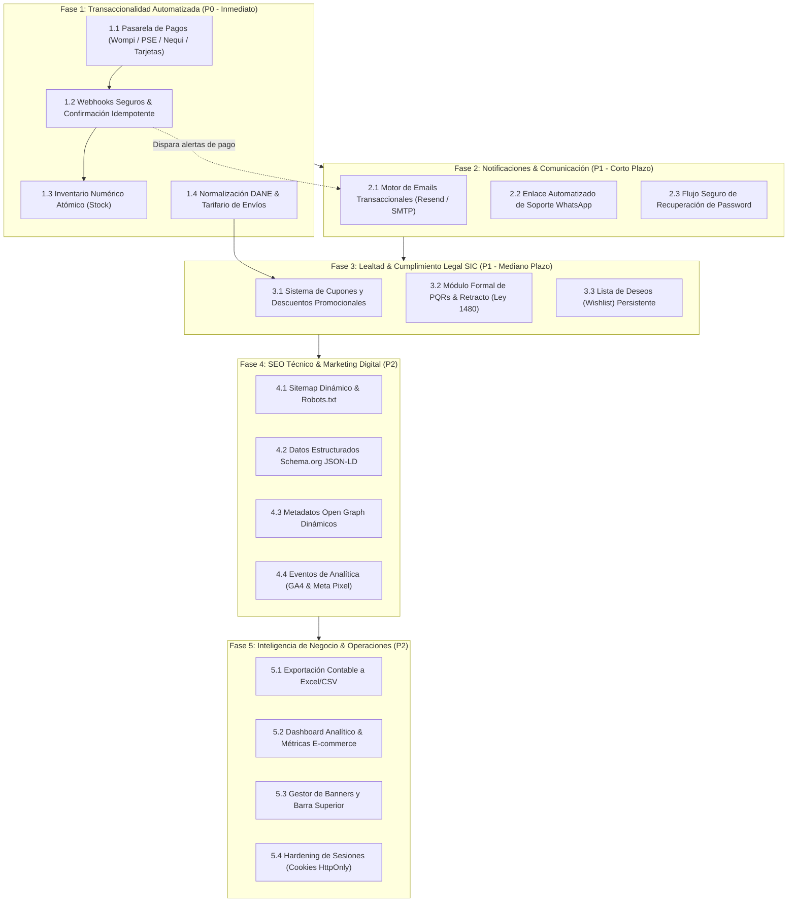

# ALMARTE ARTESANOS — Hoja de Ruta Técnica y Próximas Implementaciones (Roadmap)
> **Versión:** 1.0 — Octubre 2026  
> **Estado:** Documento Vivo / Plan Estratégico de Evolución Técnica  
> **Stack:** Next.js (App Router) + React 19 + TypeScript + TailwindCSS + Prisma (MariaDB / MySQL en Hostinger)  
> **Moneda Oficial:** Pesos Colombianos (COP)  
> **Rama de Desarrollo:** `develop` | **Rama de Producción Protegida:** `main` (Auto-deploy a Hostinger)

---

## 1. Visión General y Propósito de este Documento

Este documento consolida la planificación estratégica y técnica de las **próximas implementaciones** para la plataforma de comercio electrónico **Almarte Artesanos**. Su objetivo es proporcionar a los desarrolladores, administradores y agentes de inteligencia artificial una guía estructurada, priorizada y accionable para transformar la base sólida actual en una operación e-commerce automatizada, escalable y en estricto cumplimiento de la normativa colombiana.

---

## 2. Diagnóstico del Estado Actual vs. Brechas Técnicas

### 2.1. Funcionalidades Ya Implementadas (Baseline)
- [x] **Arquitectura Base:** Next.js App Router sobre React 19 con soporte para Server y Client Components.
- [x] **Base de Datos y Persistencia:** Prisma ORM integrado con `@prisma/adapter-mariadb`, con pool controlado de máximo 10 conexiones para Hostinger y entorno Docker local.
- [x] **Catálogo Interactivo:** Filtrado dinámico por categorías, subcategorías, disponibilidad y ofertas con badges condicionales.
- [x] **Detalle de Producto:** Vista enriquecida con galería de fotos (Cloudinary), zoom, propiedades minerales y componentes de reseñas.
- [x] **Carrito Persistente:** Estado global en cliente vía `LocalStorage` con panel lateral `<CartDrawer />`.
- [x] **Checkout Híbrido:** Admite compras de usuarios registrados o invitados directos con recálculo defensivo de precios en el servidor.
- [x] **Estándar de Moneda (COP):** Formateo estricto con `formatCOP` y sanitización con `parseCOPPrice` y `isValidCOPPrice`.
- [x] **Panel Administrativo Base:** Gestión de productos, carga multimedia a Cloudinary, visualización de órdenes y asignación manual de guías de despacho.
- [x] **Flujo de Ramas Git:** Regla estricta de trabajo en `develop` y protección total de `main` (auto-deploy a producción).
- [x] **Control de Inventario Atómico (IMP-03):** Stock cuantitativo en Prisma, decremento atómico con `$transaction`, bloqueo de fila contra sobreventa concurrente y badges visuales de escasez.
- [x] **Pasarela de Pagos Wompi Oficial (IMP-01 & IMP-02):** Métodos de pago colombianos (Bancolombia, Nequi, PSE, Tarjetas), firma criptográfica de integridad SHA-256, widget interactivo y redirección web, webhook seguro idempotente y verificación post-redirección.

### 2.2. Brechas Técnicas que Requieren Implementación
1. **Cobros Manuales:** El checkout actual genera una orden `pending` e instruye al cliente a transferir por Nequi/Bancolombia y enviar el comprobante por WhatsApp. Falta pasarela automatizada (Wompi / PSE / Tarjetas).
2. **Ausencia de Notificaciones Transaccionales:** Ni el cliente ni el administrador reciben correos electrónicos automáticos ante órdenes, pagos o despachos.
3. **Tarifario de Envíos Estático:** El checkout no calcula fletes diferenciados por ciudad o departamento, ni valida municipios con el estándar DANE.
4. **Módulo de PQRs sin Consecutivo Legal:** La política estipula atención de reclamos y retracto en 5 días hábiles, pero falta el formulario técnico con consecutivo oficial y conteo de términos legales ante la SIC.
5. **Seguridad y Cuentas:** El almacenamiento de sesiones JWT reside en `localStorage` (debe migrar a cookies `HttpOnly`) y no existe recuperación de contraseña por email.

---

## 3. Diagrama de Fases y Dependencias Críticas



---

## 4. Desglose Detallado de Implementaciones

### 🚀 Fase 1: Transaccionalidad Automatizada y Liquidación Comercial (Prioridad P0 — Inmediata)

El objetivo de esta fase es eliminar la intervención humana en la verificación de pagos y cálculo de fletes, habilitando ventas directas 24/7.

#### 1.1. Integración de Pasarela de Pagos Oficial para Colombia (Wompi) — [COMPLETADO]
* **Objetivo:** Ofrecer los métodos de pago predilectos del mercado colombiano: **Bancolombia (Botón / QR), Nequi directo, PSE para todas las entidades bancarias y tarjetas de crédito/débito**.
* **Arquitectura de Solución:**
  * Integrar el Widget checkout de Wompi o redirección mediante firma de integridad (`SHA256(reference + amount_in_cents + currency + integrity_secret)`).
  * Moneda en centavos COP (`total * 100`) sin decimales.
  * Cero almacenamiento de números de tarjeta en el servidor de Almarte (cumplimiento PCI-DSS nivel 4).
* **Archivos Clave:**
  * `lib/wompi.ts`: Cliente utilitario para generar firmas criptográficas y consultar transacciones.
  * `app/checkout/page.tsx`: Invocación del widget tras la creación de la orden.

#### 1.2. Webhook Seguro de Pagos con Idempotencia — [COMPLETADO]
* **Objetivo:** Recibir la confirmación asíncrona de la pasarela y actualizar automáticamente el estado de la orden a `paid`.
* **Criterios Técnicos:**
  * Endpoint: `POST /api/webhooks/wompi`.
  * Verificación obligatoria de la firma del evento (`event.signature.checksum`) usando el secreto de eventos de Wompi.
  * Idempotencia estricta: Si el evento ya fue procesado (`orders.payment_intent_id == transaction.id`), responder `200 OK` de inmediato sin duplicar operaciones.
  * Transición atómica de estados: Orden pasa de `pending` a `paid`, actualiza notas en `shipments`, y confirma el inventario reservado.

#### 1.3. Control de Inventario Cuantitativo (Stock Numérico Atómico)
* **Objetivo:** Evitar sobreventa de piezas artesanales exclusivas.
* **Cambios en Esquema Prisma (`prisma/schema.prisma`):**
  ```prisma
  model Product {
    // ... campos actuales
    stock Int @default(0)
    lowStockAlert Int @default(2) @map("low_stock_alert")
  }
  ```
* **Lógica Transaccional:**
  * Al confirmarse el pago en el webhook, ejecutar `$transaction`:
    ```typescript
    await prisma.$transaction(
      order.orderItems.map(item =>
        prisma.product.update({
          where: { id: item.productId },
          data: {
            stock: { decrement: item.quantity },
            // Desactiva disponibilidad si llega a cero
            isAvailable: { set: true } // validado con cálculo post-update
          }
        })
      )
    );
    ```
* **UI en Catálogo y Detalle:**
  * Si `stock <= 3` y `stock > 0`, mostrar badge: *"¡Solo quedan X unidades disponibles!"*.
  * Si `stock === 0`, inhabilitar botón «Añadir al Carrito» y marcar badge «Agotado».

#### 1.4. Tarifario Logístico y Normalización Geográfica DANE
* **Objetivo:** Liquidar el costo exacto de flete antes del pago final y evitar paquetes devueltos por direcciones erróneas.
* **Diseño Funcional:**
  * Selector jerárquico de **Departamento** y **Municipio** con base en la codificación oficial DIVIPOLA / DANE de Colombia.
  * Reglas de tarifario:
    * **Envío Local (Medellín y Valle de Aburrá):** $10.000 COP.
    * **Ciudades Principales (Bogotá, Cali, Barranquilla, Bucaramanga, etc.):** $15.000 COP.
    * **Trayectos Especiales / Reexpedición:** $22.000 COP.
    * **Regla Comercial de Envío Gratis:** Compras superiores a **$180.000 COP** obtienen flete gratuito automático.
* **Modelo Prisma:**
  * Añadir `shippingCost Decimal @default(0) @map("shipping_cost")` en `Order`.

---

### 📬 Fase 2: Notificaciones Transaccionales y Comunicación (Prioridad P1 — Corto Plazo)

El objetivo de esta fase es brindar total certeza al cliente sobre el estado de su dinero y el viaje de su paquete.

#### 2.1. Motor de Correos Electrónicos Transaccionales (Resend / SMTP Hostinger)
* **Objetivo:** Envío de correos automáticos en HTML responsive con el diseño de Almarte (colores marfil, verde olivo y terracota).
* **Plantillas Transaccionales Requeridas:**
  1. `OrdenRegistrada`: Envío de resumen del pedido, instrucciones de pago (para pedidos con método manual) o confirmación de inicio de procesamiento.
  2. `PagoConfirmado`: Recibo digital con valor liquidado en COP, número de orden y fecha estimada de preparación artesanal.
  3. `GuiaDespacho`: Notificación con nombre de transportadora (ej. Coordinadora, Envia) y enlace directo a la web de rastreo con su número de guía.
  4. `AlertaAdminNuevaVenta`: Notificación al correo interno de Almarte con los datos del comprador y productos a empacar.
* **Implementación:**
  * Uso de librería `resend` o `nodemailer` con pool SMTP seguro de Hostinger.
  * Componentes de correo estilizados mediante `@react-email/components`.

#### 2.2. Agilización de Contacto y Comprobantes por WhatsApp
* **Objetivo:** Reducir la fricción para clientes que prefieren soporte humano o pago manual.
* **Implementación:**
  * Botón contextual en pantalla de post-checkout `/checkout`:
    ```typescript
    const waMessage = encodeURIComponent(
      `¡Hola Almarte! Acabo de registrar la Orden #${order.id} por valor de ${formatCOP(order.total)}. Adjunto mi soporte de pago.`
    );
    const waUrl = `https://wa.me/573XXXXXXXXX?text=${waMessage}`;
    ```

#### 2.3. Flujo Seguro de Recuperación de Contraseña
* **Objetivo:** Permitir a clientes registrados recuperar el acceso a su cuenta sin intervención de soporte técnico.
* **Rutas:**
  * `POST /api/auth/forgot-password`: Genera token de reseteo cifrado con expiración de 15 minutos en BD y despacha correo. Respuesta genérica para evitar enumeración de usuarios.
  * `POST /api/auth/reset-password`: Valida token, actualiza hash de contraseña con bcrypt y anula el token de un solo uso.
  * Páginas frontend: `/cuenta/recuperar` y `/cuenta/restablecer?token=...`.

---

### 🎁 Fase 3: Lealtad, Promociones y Cumplimiento Normativo SIC (Prioridad P1 — Mediano Plazo)

El objetivo de esta fase es incrementar el ticket promedio, fidelizar clientes y blindar jurídicamente la operación ante la Superintendencia de Industria y Comercio.

#### 3.1. Sistema de Cupones y Descuentos Promocionales
* **Nuevo Modelo Prisma (`prisma/schema.prisma`):**
  ```prisma
  enum DiscountType {
    percentage
    fixed_cop
  }

  model Coupon {
    id            Int          @id @default(autoincrement())
    code          String       @unique @db.VarChar(50)
    type          DiscountType
    value         Decimal      @db.Decimal(10, 2)
    minPurchase   Decimal?     @map("min_purchase") @db.Decimal(10, 2)
    maxUses       Int?         @map("max_uses")
    usedCount     Int          @default(0) @map("used_count")
    expiresAt     DateTime?    @map("expires_at")
    isActive      Boolean      @default(true) @map("is_active")
    createdAt     DateTime     @default(now()) @map("created_at")

    @@map("coupons")
  }
  ```
* **Lógica de Validación:**
  * Endpoint `POST /api/checkout/apply-coupon`: Valida vigencia, stock de usos y monto mínimo en COP en el backend.
  * El frontend no aplica descuentos por cuenta propia; el recálculo ocurre siempre en el servidor.

#### 3.2. Módulo Formal de PQRs y Derecho de Retracto (Ley 1480 de 2011)
* **Objetivo:** Cumplir formalmente con la obligación de canal de Peticiones, Quejas, Reclamos y Retracto ante la SIC.
* **Funcionalidad:**
  * Formulario público `/pqrs` con campos: Nombre, Correo, Cédula, Orden asociada (opcional), Tipo (Petición, Queja, Reclamo, Retracto de compra en 5 días hábiles) y Descripción.
  * Generación de código consecutivo único: `PQR-2026-XXXX`.
  * Contador legal: Marca fecha límite de respuesta obligatoria de 15 días hábiles.
  * Notificación automática por correo al usuario con su número de radicado.
  * Sección en el panel administrativo `/admin/pqrs` para revisar radicados y redactar respuestas formales con acuse de recibo.

#### 3.3. Lista de Deseos (Wishlist) Persistente
* **Funcionalidad:**
  * Botón de corazón en cada `<ProductCard />` y en `<ProductDetails />`.
  * Para usuarios autenticados: Persistencia en base de datos.
  * Para usuarios invitados: Persistencia en `localStorage` con opción de sincronizar al iniciar sesión.

---

### 🌐 Fase 4: SEO Técnico, Datos Estructurados y Marketing Digital (Prioridad P2)

El objetivo de esta fase es maximizar el tráfico orgánico en Google y enriquecer la experiencia en redes sociales.

#### 4.1. Generación Dinámica de `sitemap.xml` y `robots.txt`
* **Implementación en Next.js App Router:**
  * `app/sitemap.ts`: Consulta en tiempo de build o revalidación todos los productos activos (`/producto/[id]`), categorías (`/catalogo?category=...`) y páginas estáticas (`/contacto`, `/envios`, `/terminos`).
  * `app/robots.ts`: Permite rastreo general y bloquea explícitamente `/admin/*`, `/api/*` y `/cuenta/*`.

#### 4.2. Microdatos Schema.org (JSON-LD)
* **Implementación:**
  * Inyección de bloques `<script type="application/ld+json">` en páginas de producto:
    * Esquema `Product` con `name`, `description`, `image`, `sku`.
    * Esquema `Offer` con `priceCurrency: "COP"`, `price`, `availability` (`InStock` / `OutOfStock`), `seller: "Almarte Artesanos"`.
    * Esquema `AggregateRating` promediando las reseñas verificadas en MariaDB.

#### 4.3. Open Graph e Imágenes Dinámicas para Redes Sociales
* **Implementación:**
  * Configuración de `generateMetadata` en `app/producto/[id]/page.tsx` para generar tags `og:title`, `og:description`, `og:image` y `twitter:card`.
  * Previsualizaciones ricas con fotografía de portada del mineral y precio en COP al compartir enlaces por WhatsApp o Instagram.

#### 4.4. Eventos de Analítica y Conversión (GA4 & Meta Pixel CAPI)
* **Eventos Estándar de E-commerce:**
  * `view_item_list` (Catálogo)
  * `view_item` (Detalle de Producto)
  * `add_to_cart` (Añadir al Carrito)
  * `begin_checkout` (Inicio de Checkout)
  * `purchase` (Confirmación de compra con valor monetario en COP)

---

### 💼 Fase 5: Inteligencia de Negocio y Operaciones Administrativas (Prioridad P2)

El objetivo de esta fase es facilitar la contabilidad, el empaque masivo y el control de directores de la tienda.

#### 5.1. Exportación Contable y Operativa a Excel / CSV
* **Funcionalidad en `/admin/ordenes`:**
  * Botón «Exportar Reporte de Ventas» con filtro por rango de fechas y estado de pago.
  * Columnas formateadas: ID de Orden, Fecha, Cliente, Cédula/NIT, Teléfono, Ciudad, Dirección, Transportadora, Guía, Subtotal COP, Flete COP, Total COP, Método de Pago.
  * Generación ligera mediante `exceljs` o formateo CSV para carga en software contable (Siigo, Alegra, etc.).

#### 5.2. Dashboard Analítico de Métricas Clave
* **Indicadores en `/admin`:**
  * Ingresos totales del mes en COP.
  * Ticket promedio de compra (AOV).
  * Top 5 productos más vendidos.
  * Tasa de conversión de pedidos registrados vs pagados.
  * Tasa de compras de invitados vs clientes registrados.

#### 5.3. Gestor de Banners y Barra Superior Informativa
* **Funcionalidad:**
  * Tabla `announcements` para controlar la barra superior de anuncios del Navbar (ej. *"✨ Envíos gratis por compras superiores a $180.000 COP a toda Colombia"*).
  * Interruptor de encendido/apagado y enlace de destino configurable desde `/admin`.

#### 5.4. Hardening de Sesiones (Migración a Cookies HttpOnly)
* **Objetivo:** Eliminar el token JWT de `localStorage` para mitigar vectores de ataque XSS.
* **Implementación:**
  * Configurar emisión del token en encabezado `Set-Cookie` con banderas `HttpOnly; Secure; SameSite=Lax; Path=/`.
  * Actualizar `middleware.ts` para leer la cookie de sesión nativamente en cada petición sin depender de cabeceras manuales en el cliente.

---

## 5. Matriz de Priorización, Esfuerzo e Impacto

| ID | Iniciativa / Módulo | Prioridad | Complejidad / Esfuerzo | Impacto en Negocio | Archivos / Componentes Afectados |
| :--- | :--- | :---: | :---: | :---: | :--- |
| **IMP-01** | Pasarela de Pagos Wompi (PSE, Nequi, Tarjetas) | **P0** | Alta | 🔥 Crítico | `lib/wompi.ts`, `app/checkout/page.tsx` |
| **IMP-02** | Webhooks de Pago con Firma Criptográfica | **P0** | Media | 🔥 Crítico | `app/api/webhooks/wompi/route.ts` |
| **IMP-03** | Inventario Cuantitativo Atómico (Stock) | **P0** | Media | 🟢 Completado | `prisma/schema.prisma`, `app/api/checkout/*` |
| **IMP-04** | Tarifario Logístico y Ciudades DANE | **P0** | Media | 🔥 Crítico | `components/LocationSelector.tsx`, `app/checkout/page.tsx` |
| **IMP-05** | Motor de Emails Transaccionales (Resend/SMTP) | **P1** | Media | ⭐ Alto | `lib/email.ts`, `components/emails/*` |
| **IMP-06** | Enlace Asistido de Soporte WhatsApp | **P1** | Baja | ⭐ Alto | `app/checkout/page.tsx` |
| **IMP-07** | Recuperación Segura de Contraseña por Email | **P1** | Media | ⭐ Alto | `app/api/auth/*`, `app/cuenta/*` |
| **IMP-08** | Sistema de Cupones y Descuentos | **P1** | Media | ⭐ Alto | `prisma/schema.prisma`, `app/api/coupons/*` |
| **IMP-09** | Módulo Legal de PQRs y Retracto (SIC) | **P1** | Media | ⚖️ Regulatorio | `app/pqrs/page.tsx`, `app/admin/pqrs/*` |
| **IMP-10** | Lista de Deseos (Wishlist) Persistente | **P2** | Baja | 👍 Medio | `context/WishlistContext.tsx`, `components/ProductCard.tsx` |
| **IMP-11** | SEO Dinámico: Sitemap, Robots y Schema.org | **P2** | Baja | 📈 Estratégico | `app/sitemap.ts`, `app/robots.ts`, `app/producto/*` |
| **IMP-12** | Eventos de Analítica (GA4 & Meta Pixel) | **P2** | Baja | 📈 Estratégico | `components/AnalyticsProvider.tsx` |
| **IMP-13** | Exportación Contable de Órdenes a Excel/CSV | **P2** | Baja | 💼 Operativo | `app/admin/ordenes/page.tsx` |
| **IMP-14** | Hardening de Sesiones a Cookies HttpOnly | **P2** | Media | 🛡️ Seguridad | `app/api/auth/*`, `middleware.ts`, `context/AuthContext.tsx` |

---

## 6. Reglas Técnicas Obligatorias para la Ejecución de las Tareas

Cualquier desarrollador o agente que aborde una iniciativa de esta hoja de ruta debe ceñirse sin excepción a las siguientes reglas del proyecto:

1. **Gestor de Paquetes Exclusivo:** Usar únicamente `yarn` (`yarn add`, `yarn install`, `yarn build`, `yarn start`). Prohibido `npm` y `pnpm`.
2. **Formateo Monetario en COP:** Todo precio renderizado o ingresado debe procesarse mediante `formatCOP`, `parseCOPPrice` y validarse con `isValidCOPPrice` (mínimo $1.000 COP).
3. **Estrategia de Ramas Git:**
   - La rama `main` tiene auto-deploy a Hostinger y **SOLO se toca si el usuario lo permite explícitamente**.
   - Toda implementación, commit y push debe realizarse exclusivamente sobre la rama `develop`.
4. **Respeto a las Restricciones de Hostinger:**
   - Mantener el pool de conexiones a MySQL en un máximo de 10 conexiones simultáneas (`lib/db.ts`).
   - Cero subida de imágenes al servidor local; usar exclusivamente Cloudinary.
5. **Protocolo de Documentación Continua:**
   - Al completar cada tarea, registrar obligatoriamente la entrada en `docs/CHANGELOG.md`.
   - Si se agregan modelos en Prisma o nuevos endpoints, actualizar el manual maestro [docs/documentation.md](file:///c:/Users/juanm/OneDrive/Documentos/desarrollo/almarte/almarte-ecommerce/docs/documentation.md).
